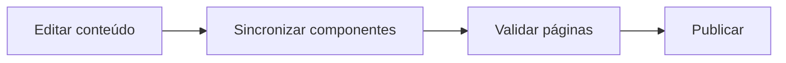

<div align="center">

<h1>🌱 Projeto GAIA &#183; UFTM</h1>
<p><strong>Projetos, pessoas, conquistas e conte&#250;do t&#233;cnico em um site est&#225;tico.</strong></p>
<p><kbd>HTML &#183; CSS &#183; JavaScript &#183; Python</kbd></p>

<p><a href="https://github.com/Pedronsjaja/gaiarobotica-new.github.io/stargazers"></a> <a href="https://github.com/Pedronsjaja/gaiarobotica-new.github.io/commits/main"></a></p>
<p><a href="#inicio-rapido">Comece aqui</a> · <a href="#guia-do-projeto">Documentação</a> · <a href="https://github.com/Pedronsjaja/gaiarobotica-new.github.io/tree/main">Arquivos</a></p>

</div>

<a id="inicio-rapido"></a>
## 🚀 Comece aqui

**[Visitar o site do projeto](https://gaiarobotca.github.io/gaiarobotica-new.github.io/)**

> Esta é uma cópia de desenvolvimento com histórico. Créditos, autoria e instruções do projeto original estão preservados na documentação abaixo.

| Conteúdo | Manutenção | Qualidade |
| --- | --- | --- |
| Projetos, equipe, notícias, conquistas e guias. | Componentes compartilhados e metadados sincronizados. | Validação estática e verificações no navegador. |

### Caminho do projeto



<a id="guia-do-projeto"></a>
## 📖 Documentação

Site do projeto GAIA, com projetos, equipe, conquistas e guias de robótica.

- Site: https://gaiarobotca.github.io/gaiarobotica-new.github.io/
- Link para a bio: https://gaiarobotca.github.io/gaiarobotica-new.github.io/paginas/portal.html
- Instagram: https://www.instagram.com/gaia.robotica/

## Marca

O site representa o **Projeto GAIA**, que reúne as áreas **GAIA Robótica** e **GAIA Eletroquad**. O cabeçalho e o rodapé usam GAIA com a assinatura “PROJETO · UFTM”. O monograma vetorial `assets/images/marca/gaia-g.svg` também é usado como ícone das abas. Os componentes compartilhados são gerados por `scripts/sync_site.py`.

## Organização

```text
index.html                Página inicial e equipe
paginas/                  Aprenda, contato, patrocínio, ex-membros e portal
artigos/                  Guias técnicos
noticias/                 Histórias dos projetos
conquistas/               Resultados e galerias
assets/css/site.css       Identidade visual, navegação e componentes gerais
assets/css/articles.css   Componentes compartilhados dos tutoriais
assets/css/stories.css    Leitura das notícias e conquistas
assets/css/pages/         Layouts específicos das páginas
assets/js/site.js         Menu, sumário, leitura, cópia de código e galerias
assets/js/pages/          Busca/filtros e formulários
assets/images/            Imagens por assunto, com nomes e formatos normalizados
data/site.json            Endereço público, títulos e descrições
data/team.json            Integrantes da grade da equipe
data/images.json          Correspondência entre arquivos originais e imagens do site
scripts/                  Sincronização e validação
```

Os pequenos HTML na raiz, como `aprenda.html` e `artigo-pid.html`, preservam os endereços antigos e redirecionam para as páginas organizadas. Edite o conteúdo nas pastas, não nesses redirecionamentos. `index.html` continua sendo a entrada do site.

## Editar e visualizar

Não há dependência de um framework ou servidor de aplicação. O conteúdo e a navegação são HTML estático.

```sh
python -m http.server 8765 --bind 127.0.0.1
```

Abra http://127.0.0.1:8765/. Não use `file://` para testar recursos de área de transferência.

1. Edite o HTML da página e, se necessário, seu CSS em `assets/css/pages/`.
2. Para o cabeçalho/rodapé compartilhados, edite os modelos em `scripts/sync_site.py`.
3. Para títulos de compartilhamento, descrições e endereço público, edite `data/site.json`.
4. Execute `python scripts/sync_site.py` para atualizar componentes compartilhados, metadados, sitemap e redirecionamentos.
5. Execute `python scripts/validate_site.py` antes de enviar as alterações.

Os blocos delimitados por `shared-header`, `shared-footer`, `page-meta` e `team-members` são gerados pelo script. A execução preserva todo o conteúdo fora desses blocos.

## Atualizar a equipe

Adicione o retrato em `assets/images/equipe/`, preferencialmente WebP, com nome sem espaços ou acentos. Atualize nome, função e caminho em `data/team.json` e execute `python scripts/sync_site.py`.

Um integrante com `"photo": null` recebe suas iniciais em um avatar circular. A sincronização ordena os nomes alfabeticamente, desconsiderando acentos e maiúsculas, nas grades de membros atuais e ex-membros. Para mover alguém da equipe atual para ex-membros, altere `status` de `active` para `former` e execute a sincronização: as duas páginas são atualizadas pelo mesmo cadastro. O campo opcional `period` registra apenas períodos conhecidos. Liderança e docentes ficam no bloco próprio de `index.html`.

A lista foi atualizada conforme os nomes informados pelo capitão: Eloiza Lopes, Laura Castro e Julia Alves estão em ex-membros; os 15 novos integrantes constam na equipe atual. Julia Alves e Júlia Origuela são pessoas diferentes; Júlia Origuela permanece na diretoria. As fotos disponíveis foram mantidas nos respectivos cadastros e os novos integrantes usam iniciais até receberem retratos.

## Colaborador

[Pedro H. Soares (@Pedronsjaja)](https://github.com/Pedronsjaja), capitão do GAIA, é o colaborador responsável pelo desenvolvimento e manutenção deste site. Seu crédito é publicado no rodapé e no cartão da liderança. Os créditos compartilhados são configurados em `data/site.json`.

## Carrinho Bluetooth

O projeto fotografado é um carrinho controlado por Bluetooth, com dois motores, driver e Arduino. O artigo `artigos/carrinho-bluetooth.html` apresenta seus componentes, funcionamento e objetivos de aprendizagem. A foto usa o nome `carrinho-bluetooth.webp`; o nome histórico permanece como chave em `data/images.json`. O guia de seguidor de linha usa uma ilustração didática própria.

## Fotos

Os arquivos com extensão JPG/PNG que continham HEIC foram convertidos. Imagens repetidas compartilham o mesmo arquivo; `data/images.json` registra a correspondência, o formato original e o hash. Fotos de pessoas não foram substituídas por imagens geradas.

As capas distintas de Arduino e inteligência artificial foram obtidas no Wikimedia Commons e estão salvas em `assets/images/artigos/`. Consulte [os créditos, fontes e licenças](assets/images/CREDITS.md). Esses créditos também aparecem junto ao conteúdo do site.

Os originais foram preservados fora da pasta publicada, em `../gaia-midias-originais-20260919/`, além do backup ZIP criado antes da reorganização. As versões anteriores também ficam no histórico Git. Para inserir novas imagens, exporte no formato real indicado pela extensão e confira os nomes com diferenciação entre maiúsculas e minúsculas: o GitHub Pages usa caminhos sensíveis a isso.

## Contato e patrocínio

Os formulários preparam uma mensagem no aplicativo de e-mail ou copiam o texto. **O visitante ainda precisa enviar o e-mail.** Não há serviço de envio ou armazenamento de mensagens no site. A interface explica esse comportamento e mantém os canais diretos de contato.

## Validação

O validador estático usa apenas a biblioteca padrão do Python e verifica caminhos, maiúsculas/minúsculas, âncoras, IDs, imagens e estrutura das páginas. Não confirma a disponibilidade de links externos.

Para repetir os testes no navegador, instale as ferramentas em um ambiente virtual:

```sh
python -m venv .venv
# Ative o ambiente conforme seu sistema operacional.
python -m pip install playwright
python -m playwright install chromium
python scripts/check_browser.py
```

Mantenha o servidor local na porta 8765 em outro terminal. O teste cobre as 22 páginas em quatro larguras, menu mobile, imagens, busca, rascunhos, galerias e redirecionamentos. Os rascunhos são testados localmente; nenhuma mensagem é enviada. Capturas e relatório são salvos na pasta temporária do sistema.

## Publicação

As prévias de compartilhamento usam `assets/images/social/gaia-g-preview-hd.png` (2400 × 2400), com apenas o G verde centralizado sobre fundo azul-escuro para facilitar o reconhecimento em miniaturas quadradas. Os cartões largos do Twitter/X usam `gaia-g-preview-horizontal-hd.png` (2400 × 1260). As duas artes também estão disponíveis em SVG, sem dependências de fontes externas. O título e a descrição continuam específicos de cada página. As imagens e os metadados Open Graph/Twitter são definidos em `scripts/sync_site.py`.

O GitHub Pages deste repositório publica a raiz da branch `main`. Depois de validar, envie o commit e acompanhe a execução de `pages build and deployment` no GitHub Actions. Confira o site publicado antes de divulgar o link do portal na bio.

Fontes das correções históricas, como o resultado da SAE em junho de 2025 e o HackaGIS Saúde, estão vinculadas nos próprios relatos.

